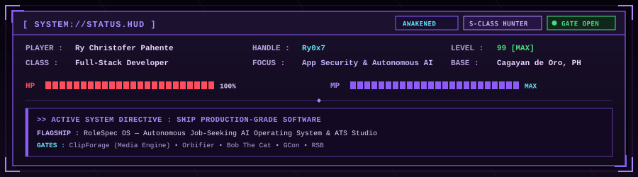

 

 

---

## 🗡️ About Me

> **`$ whoami`**  
> *Full-stack developer focused on secure application development, deliberate systems design, and delivering software that reaches production.*

I am a software engineer and independent security researcher based in Cagayan de Oro, Philippines. I build at the intersection of practical, high-leverage software and application security — creating autonomous AI toolkits, desktop companions, and developer utilities while hunting vulnerabilities before they reach production.

- 🌐 **Portfolio & Case Studies:** [ry0x7.dev](https://ry0x7.dev/)
- 🎯 **Primary Focus:** Autonomous AI operating systems, local desktop tooling, and application security
- ⚔️ **Hackathons:** 1st Runner-Up (Hack4Gov 2, Region 10), 5th Place (Hack4Gov 3, Region 10)
- ☕ **Support:** Help fund hosting and development on [Ko-fi](https://ko-fi.com/ry0x7)

---

## 👑 Flagship Build // S-Class Spotlight

### 🌟 [RoleSpec OS](https://github.com/Ry0x7/rolespec-os)
> **The Autonomous, Self-Hosted Job-Seeking AI Operating System.**  
> Built to eliminate fragmented $30/month subscriptions across resume builders, keyword scrapers, spreadsheets, and outreach tools.

  

  
  
  
  
  
  
  

#### Core Features
- 🎯 **ATS Scoring & Smart Resume Studio:** Token-matching algorithms and real-time score auditing across 5 critical dimensions with line-by-line Action–Result–Reason rewrites and pixel-perfect PDF exports.
- ⚡ **Zero-API-Key AI Engine:** Direct integration with your existing **ChatGPT Plus** or **Claude Pro** subscriptions via CLI (`codex-cli` / `claude-code`) or offline local models via Ollama.
- 📊 **Opportunity Pipeline:** 7-stage Kanban workspace with scam & ghost-job detection, automated visa/clearance extraction, and recruiter follow-up nudges.
- 🧩 **Standalone Chrome Extension (MV3):** 1-click job clipping from LinkedIn, Indeed, Greenhouse, Lever, and Workday directly into your local dashboard.

[📂 View RoleSpec OS Repo](https://github.com/Ry0x7/rolespec-os) · [⚡ Quickstart Guide](https://github.com/Ry0x7/rolespec-os#readme) · [☕ Sponsor on Ko-fi](https://ko-fi.com/ry0x7)

---

## 🌌 System Gates // Active Public Projects

<strong>🎬 Gate 01 · ClipForage — All-in-One Video Editor Resource Engine</strong>

 

### [ClipForage](https://github.com/Ry0x7/ClipForage-source)
> One search for memes, green screens, B-roll, overlays, sound effects, music, fonts, and LUTs with license verification on every result.

  
  
  
  
  
  

- **Multi-Source Unified Search:** Aggregates YouTube, Openverse, Wikimedia Commons, Internet Archive, Pexels, and Pixabay.
- **Auto Chroma Key-out:** Automatic green screen removal directly into transparent WebM clips via ffmpeg.
- **License Sidecars:** Downloads include matching `.json` attribution manifests for legal clarity.
- **DaVinci Resolve Integration:** 1-command bin importer into DaVinci Resolve timelines.

🔗 [Repository](https://github.com/Ry0x7/ClipForage-source) · [Portfolio Overview](https://ry0x7.dev/ClipForage)

<strong>🐱 Gate 02 · Bob The Cat — Windows Desktop Virtual Pet</strong>

 

### [Bob The Cat](https://github.com/Ry0x7/BobTheCat)
> An offline Windows desktop companion with autonomous routines, gesture hover petting, window perching, and yarn/laser toys.

  
  
  
  
  

- **Autonomous Routine Engine:** Loafing, stretching, grooming, rolling, hopping, window-edge gripping, and zoomies.
- **Hover Petting:** Stroke cursor vertically over fur to trigger relaxation and cat meows.
- **Zero-Dependency Native Build:** Built purely on native .NET Framework Win32 layered windows with no runtime NuGet packages.

🔗 [Repository](https://github.com/Ry0x7/BobTheCat) · [Interactive Preview](https://ry0x7.dev/BobTheCat)

<strong>🕹️ Gate 03 · Orbifier — Discord Quest & Presence Helper</strong>

 

### [Orbifier](https://github.com/Ry0x7/orbifier)
> Educational Discord quest assistant with a retro 2D pixel-art GUI, process detection spoofing, and automated quest countdown timers.

  

  
  
  
  

- **Pixel-Art Interface:** Custom canvas-rendered 5x7 bitmap fonts and animated pixel orb logo.
- **Database & Steam Modes:** Look up Discord detectable game processes and write lightweight Steam appmanifests.
- **Countdown Manager:** Multi-quest active monitor with automatic cleanup on completion.

🔗 [Repository](https://github.com/Ry0x7/orbifier) · [Latest Release](https://github.com/Ry0x7/orbifier/releases)

<strong>📅 Gate 04 · GCon — Visual GitHub Contribution Studio</strong>

 

### [GCon](https://github.com/Ry0x7/GCon)
> Full-stack visual commit generator and calendar designer for scheduled contribution patterns.

  
  
  
  
  

- **Pattern Designer:** 4-intensity commit presets (1, 3, 6, 10), pre-built templates (heart, smile), and 5x7 text.
- **Security Invariants:** Server-validated OAuth state, Fernet token encryption at rest, and strict batch payload validation.

🔗 [Repository](https://github.com/Ry0x7/GCon) · [Live Demo](https://ry0x7.dev/GCon/)

<strong>📡 Gate 05 · RodentSignalBot (RSB) — Solana On-Chain Radar</strong>

 

### [RodentSignalBot (RSB)](https://github.com/Ry0x7/RSB)
> Discord bot monitoring Solana token launches, DEX metrics, and wallet behavior with automated embed reports.

  
  
  
  

- **Real-Time Signal Feeds:** Bonding curve tracking, soaring tokens, and Telegram DEX paid monitors.
- **Analytics Aggregation:** Consolidates gmgn, Bubblemaps, CoinGecko, and checkdex APIs into rich Discord embeds.

🔗 [Repository](https://github.com/Ry0x7/RSB) · [Case Study](https://ry0x7.dev/RSB/)

---

## 💻 Tech Stack & Hunter Inventory

**Languages**

**Frontend & Desktop**

**Backend & Frameworks**

**Databases & Storage**

**DevOps, Tools & Security**

---

## ☕ Support My Work

All my major tools and software are free, private, and open-source. If RoleSpec OS, ClipForage, Orbifier, or Bob The Cat have saved you time, helped your workflow, or entertained you, consider supporting ongoing maintenance and development on Ko-fi!

  

---

## 📊 System Telemetry & Stats

---

## 📈 Activity Stream

