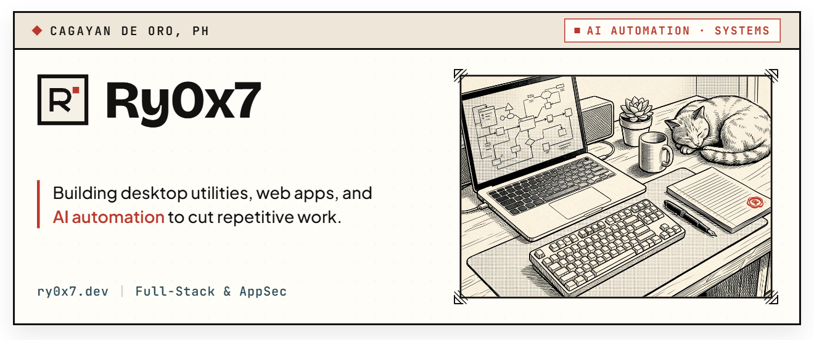
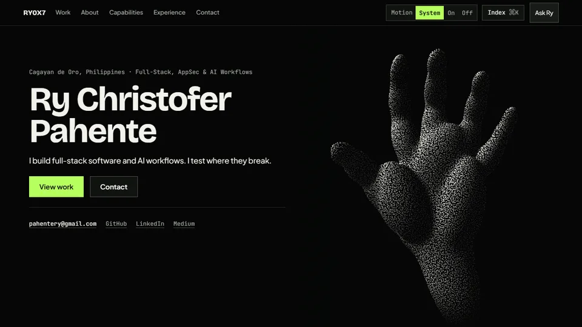

<picture>
  <source media="(prefers-color-scheme: dark)" srcset="assets/banner-dark.png" />
  <source media="(prefers-color-scheme: light)" srcset="assets/banner-light.png" />
  
</picture>

# Ry0x7

I'm a software developer based in Cagayan de Oro, Philippines. I build desktop utilities and web apps, and I'm pursuing a career in AI automation to cut repetitive work.

---

## Featured projects

- **[RoleSpec OS](https://github.com/Ry0x7/rolespec-os)** — Local-first Windows desktop and self-hosted AI career workspace. Recent [v2.0.1](https://github.com/Ry0x7/rolespec-os/releases/tag/v2.0.1) tightens resume and planner validation and keeps form entries when a submission fails.
- **[Cyron Uninstaller](https://github.com/Ry0x7/cyron-uninstaller)** — Windows utility for removing apps, analyzing disk usage, and cleaning up files. Recent [v0.2.0](https://github.com/Ry0x7/cyron-uninstaller/releases/tag/v0.2.0) adds verified uninstall confirmations and filters batch uninstalls to eligible apps.
- **[Bob The Cat](https://github.com/Ry0x7/BobTheCat)** — Offline Windows desktop pet that perches on windows and reacts to hover and toys. Recent [v0.3.0](https://github.com/Ry0x7/BobTheCat/releases/tag/v0.3.0) adds a Pomodoro timer and ear-anchored dialogue bubbles.
- **[ClipForage](https://github.com/Ry0x7/ClipForage-source)** — Local search tool for video editors that shows licenses alongside results, currently in 0.1.0 alpha.
- **[CyReSearch](https://ry0x7.dev/#episode-cyresearch)** — Federated literature search engine querying academic indexes in parallel and ranking open-access copies first. Private source, public portfolio record.
- **[Chryyptix](https://ry0x7.dev/#episode-chryyptix)** — Discord community and esports platform with a bot and admin dashboard. Private source, public portfolio record.

---

## Portfolio — SIGNAL / FORM

ry0x7.dev is a static portfolio in the monochrome SIGNAL / FORM design system. Ink-and-paper surfaces meet a scroll-linked scene with a reduced-motion fallback. See [Selected work](https://ry0x7.dev/#workstation) and the [project index](https://ry0x7.dev/#projects).

---

## Links

[Portfolio](https://ry0x7.dev/) · [LinkedIn](https://linkedin.com/in/ry0x7) · [Email](mailto:roxy0x7@proton.me) · [Ko-fi](https://ko-fi.com/ry0x7)
